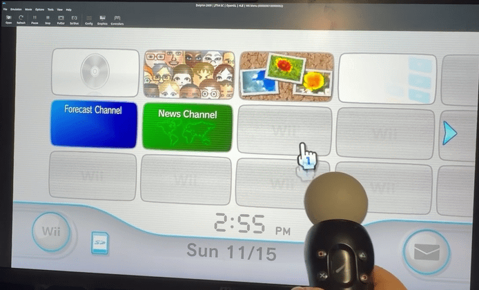
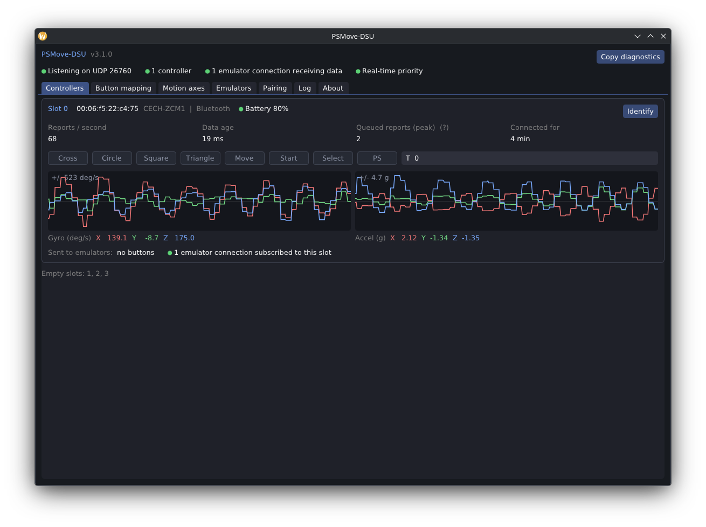

# PSMove-DSU

[](https://github.com/Swordmaster3214/PSMove-DSU/releases/latest)
[](https://github.com/Swordmaster3214/PSMove-DSU/releases)
[](LICENSE)


**Use your PlayStation Move controllers for motion controls in Dolphin, Cemu and other emulators.** Pair the controller, run PSMove-DSU, and point your emulator at it.





## Overview

PSMove-DSU is a DSU (DualShock UDP) / Cemuhook server for PlayStation Move controllers. It turns the Move's accelerometer, gyroscope and buttons into the standard DSU protocol, so any emulator with DSU motion support can use it. PS Move controllers are cheap, easy to find used, and have the motion sensors those emulators need.

Works with emulators that have a DSU client, such as:
- **Dolphin** (GameCube/Wii)
- **Cemu** (Wii U)
- **Eden / Azahar** and other Switch and 3DS emulators with DSU motion support
- **RPCS3** (PS3) and **PCSX2** (PS2), where DSU motion input is available
- Any application supporting motion controls via DSU

> **Tested with Dolphin.** This project is based on the DSU client that Dolphin provides, so any emulator that follows the protocol should work. I haven't tested the others myself, though. If one doesn't work for you, please [open an issue](https://github.com/Swordmaster3214/PSMove-DSU/issues) (use **Copy diagnostics** in the GUI) and say which emulator and version you used.

## Features

- **Cross-platform support**: Windows, macOS, and Linux
- **Built-in GUI**: live controller input, button and motion-axis remapping, pairing, emulator connection status, and a one-click diagnostics report for bug reports
- **Real-time motion data**: Accelerometer and gyroscope
- **Button support**: All PS Move controller buttons
- **DSU/Cemuhook protocol**: Compatible with all DSU-enabled applications
- **Automatic controller detection**: Plug and play functionality; controllers that are turned off are released and picked up again, in the same slot, when they reconnect
- **Rumble**: supports the DSU rumble extension, for clients that send it (Dolphin, Cemu, Azahar and Eden currently don't)

## Quick Start

1. **Download** the [latest release](https://github.com/Swordmaster3214/PSMove-DSU/releases/latest/) for your platform (Windows, macOS or Linux).
2. **Pair your PS Move controller** (the **Pairing** tab in the GUI, or see [Controller Setup](#controller-setup)), then connect it via Bluetooth.
3. **Run the executable.** A window opens; add `--headless` to run in the console only:
   - Windows: `dsu_server_psmove_win64.exe` (ARM64: `dsu_server_psmove_win_arm64.exe`)
   - macOS: `./dsu_server_psmove_macos_arm64` (Apple Silicon) or `./dsu_server_psmove_macos_x64` (Intel)
   - Linux: `./dsu_server_psmove_linux_x64` (ARM64: `./dsu_server_psmove_linux_arm64`)
4. **Configure your emulator** to connect to `127.0.0.1:26760` (the default DSU port). See [Emulator Setup](#emulator-setup).

### The GUI

| Tab | What it's for |
| --- | --- |
| **Controllers** | Every connected controller with live buttons, trigger, gyro and accelerometer graphs, battery, report rate, data age and queued-report count. **Identify** lights up and rumbles a controller so you can tell which slot it's in. |
| **Button mapping** | Choose which emulator button each PS Move button sends, and see live what the emulator receives (digital bits and analog values). |
| **Motion axes** | Choose which PS Move sensor axis feeds the emulator's pitch/yaw/roll and accelerometer X/Y/Z, and invert any of them, with live bars to check the result. |
| **Emulators** | Every DSU client that has contacted the server, which controller slots it is receiving, and how many packets per second it gets. Shows a checklist when no emulator has connected. |
| **Pairing** | Pair a USB-connected controller with one click. |
| **Log** | The server log with filters. Turn on verbose logging without restarting. |

**Copy diagnostics** (top right) copies the current status and recent log in a format ready to paste into a GitHub issue. Please include it when reporting a bug.

Mapping changes take effect immediately and are saved to a settings file:
- Windows: `%APPDATA%\PSMove-DSU\config.ini`
- macOS: `~/Library/Application Support/PSMove-DSU/config.ini`
- Linux: `~/.config/psmove-dsu/config.ini`

The headless mode uses the same file, so you can set things up in the GUI and then run with `--headless`.

### Command-line options

| Option | Description |
| --- | --- |
| `--headless` | Run without the GUI (console only). Also used automatically when no display is available. |
| `--pair` | Pair a USB-connected controller from the console |
| `--pair-nav` | Pair a USB-connected PS Move Navigation controller (see below) |
| `--verbose` | Detailed logs and latency diagnostics |
| `--config <path>` | Use a different settings file |
| `--map <p> <y> <r>` | Gyro source axis (0=X, 1=Y, 2=Z) for pitch, yaw and roll (overrides the settings file) |
| `--flip <p> <y> <r>` | Invert gyro pitch, yaw, roll (0/1) (overrides the settings file) |
| `--simulate <n>` | Add *n* virtual controllers, for testing an emulator setup without hardware |
| `--licenses` | Show the license of PSMove-DSU and of the third-party code it includes |

### Button Mappings

Default mapping (change it on the GUI's **Button mapping** tab):

Button | Mapping
--- | ---
X | Cross
O | Circle
□ | Square
∆ | Triangle
Move | R1
SELECT | Share
START | Options
T | R2
PS | PS

### Controller Setup

#### Navigation controller (Nunchuk)
The PS Move Navigation controller is not read by this server: once paired it appears as a normal gamepad, so add it as a second input source in Dolphin's Wii Remote / Nunchuk profile and let Dolphin's SDL read it, while this server supplies the Wiimote motion.

1. Connect it with a USB cable. You may need to press its PS button before it is detected.
2. Click **Pair Navigation controller** on the **Pairing** tab, or from the console run:
   ```bash
   ./dsu_server_psmove --pair-nav
   ```
3. Unplug the cable and press the PS button.
4. If it doesn't connect, turn Bluetooth off and on, or restart your computer, then press the PS button again. Pairing may not take effect until then.

**Linux:** pairing the Navigation controller only needs access to the USB device, so it works without root once the udev rules from `sudo ./dsu_server_psmove --linux-setup` are installed (replug the controller afterwards). Without them, run `--pair-nav` with `sudo`. BlueZ may also pair the controller by itself when you plug it in.

#### Bluetooth Pairing
**Note:** You will not need to do the following if you have already paired your controller with your computer using [PSMoveAPI](https://github.com/thp/psmoveapi)

Connect the controller with a USB cable, open the **Pairing** tab and click **Pair**. Or, from the console:
```bash
./dsu_server_psmove --pair
```
Then unplug the cable and press the PS button. The red LED blinks, then stays lit once the controller is connected over Bluetooth. You only need to pair once per controller and computer; pair again if you connect it to a PS3 or another PC. Over USB, controllers can be paired, charged, and have LED/rumble set, but sensor data is only available over Bluetooth.

**Troubleshooting**
- **LED keeps blinking:** the controller isn't paired with this computer, or the battery is low. Charge it over USB. Your system's Bluetooth device list should show a "Motion Controller" entry.
- **Windows:** pairing may take several attempts. Use the Microsoft Bluetooth stack and remove third-party drivers such as MotionInJoy. May need to run as administrator.
- **macOS:** if a PIN dialog appears when you press PS, close it and pair again. Since macOS Sierra the built-in adapter supports at most 2 controllers at once; use an external adapter for more.
- **Linux:** pairing a Move needs root (it registers the controller with BlueZ), so run `sudo ./dsu_server_psmove --pair` once; the udev rules don't change that. To use controllers without root (and to pair the Navigation controller without root), or if the controller pairs but won't connect (many distros' BlueZ rejects unbonded input devices), run `sudo ./dsu_server_psmove --linux-setup` (also offered at the end of `--pair` when run as root). It asks before installing the udev rules (built into the binary) and, separately, before setting `ClassicBondedOnly=false` in `/etc/bluetooth/input.conf`, which partially undoes a [Bluetooth security fix](https://github.com/advisories/GHSA-qjcj-xg77-6c32); it defaults to no and backs the file up first.

## Building from Source

### Prerequisites

#### All Platforms
- **CMake** 3.21 or higher
- **C++ compiler** with C++17 support
- **Internet access on the first configure** - CMake downloads the PSMoveAPI 4.0.12, Dear ImGui 1.91.9b and GLFW 3.4 sources (pinned and hash-verified) and compiles them statically into the server. You do *not* need to install any of them yourself.

#### Linux
```bash
sudo apt-get install libbluetooth-dev libdbus-1-dev libudev-dev pkg-config \
    libx11-dev libxrandr-dev libxinerama-dev libxcursor-dev libxi-dev libxext-dev \
    libwayland-dev libxkbcommon-dev
```
The Wayland packages are optional; without them the GUI uses X11 (XWayland). For a console-only build without any of the GUI packages, use `cmake --preset headless` (or configure with `-DDSU_BUILD_GUI=OFF`).

#### macOS
- Xcode command line tools (`xcode-select --install`)

#### Windows
- Visual Studio 2019 or higher (or Build Tools for Visual Studio)
- Windows SDK

### Build Instructions

1. **Clone the repository**:
   ```bash
   git clone https://github.com/Swordmaster3214/PSMove-DSU.git && cd PSMove-DSU
   ```

2. **Configure and build** (from the repository root, on every platform):
   ```bash
   cmake --preset release
   cmake --build --preset release
   ```

3. **Run the executable**, which is placed in `build/` with a platform suffix:
   - Linux: `./build/dsu_server_psmove_linux_x64` (or `linux_arm64`)
   - macOS: `./build/dsu_server_psmove_macos_arm64` (or `macos_x64`)
   - Windows: `build\dsu_server_psmove_win64.exe`

Other presets (debug, console-only, tests, CPU-tuned) are listed below. Without presets, the equivalent manual steps are:

```bash
cmake -S . -B build -DCMAKE_BUILD_TYPE=Release
cmake --build build --config Release
```

### Presets and Tests

`CMakePresets.json` defines these presets (list them with `cmake --list-presets`). Use the same name for the configure and build steps, e.g. `cmake --preset dev && cmake --build --preset dev`:

| Preset | What it does |
|--------|--------------|
| `release` | Release build in `build/` |
| `debug` | Debug build in `build-debug/` |
| `headless` | Release build without the GUI, in `build-headless/` |
| `dev` | Release build in `build-dev/` with tests and warnings as errors |
| `native` | Release build in `build-native/` tuned for your CPU with `-march=native` (plus LTO and `-O3`). The executable gets a `_native` suffix; it can crash with an illegal instruction on other CPUs, so don't share it |

The `dev` preset also registers the DSU protocol check with CTest. It starts the server with two simulated controllers, runs `test/dsu_protocol_check.py` against it and shuts it down (disconnect real controllers first, and stop any other running server, since it uses UDP port 26760):

```bash
cmake --preset dev && cmake --build --preset dev && ctest --preset dev
```

Other options: `-DDSU_ENABLE_LTO=OFF` (link-time optimisation is on by default for Release), `-DDSU_BUILD_TESTS=ON`, `-DDSU_WARNINGS_AS_ERRORS=ON` and `-DDSU_BUILD_GUI=OFF`. Without `-DCMAKE_BUILD_TYPE`, Makefile and Ninja builds default to Release.

### Building Offline / Custom PSMoveAPI Sources

PSMoveAPI is built from source and linked statically, so end users of a release build do not need `psmoveapi.dll`, `libpsmoveapi.so`, or any other PSMoveAPI install. If you build without internet access, point CMake at local source trees instead of downloading them:

```bash
cmake --preset release \
      -DFETCHCONTENT_SOURCE_DIR_PSMOVEAPI=/path/to/psmoveapi-4.0.12 \
      -DFETCHCONTENT_SOURCE_DIR_HIDAPI=/path/to/hidapi \
      -DFETCHCONTENT_SOURCE_DIR_IMGUI=/path/to/imgui-1.91.9b \
      -DFETCHCONTENT_SOURCE_DIR_GLFW=/path/to/glfw-3.4
```

(`hidapi` here is the [thp/hidapi](https://github.com/thp/hidapi) fork at commit `38681c7`, the revision PSMoveAPI 4.0.12 pins as a submodule.)

On Windows with MSVC the C/C++ runtime is also linked statically (so the Visual C++ Redistributable is not required); pass `-DDSU_STATIC_RUNTIME=OFF` to opt out.
## Configuration

### DSU Server Settings
The server runs on `127.0.0.1:26760` by default, which is the standard DSU port. Most applications will automatically detect the server at this address.

### Emulator Setup

#### Cemu
1. Go to **Options** → **Input settings**
2. Click **+**, and set the API to DSUController.

#### Dolphin
1. Go to **Controllers** → **Common** → **Alternate Input Sources**
2. Set source to **DSU Client** with server `127.0.0.1:26760`

#### Eden
1. Go to **Emulation** → **Configure** → **Controls**
2. Set the input device to **Motion Controller N**, where N is the number of the controller you would like to set.

## Troubleshooting

Start with the GUI: the status line at the top shows whether the server is listening, how many controllers are connected and whether any emulator is receiving data, and each tab explains what to check when something is missing. When opening an issue, click **Copy diagnostics** and paste the result.

### Controller Not Detected
- Ensure the PS Move controller is properly paired
- On Linux, install the udev rules with `sudo ./dsu_server_psmove --linux-setup` (see [Linux Permissions](#linux-permissions))
- Check that no other applications are using the controller

### Connection Issues
- Verify the server is running and listening on port 26760 (if another DSU server such as DS4Windows or BetterJoy already uses the port, PSMove-DSU now reports it instead of starting silently)
- The **Emulators** tab lists every emulator connection and which controller slots it receives. If it is empty, the emulator isn't reaching the server.
- Check firewall settings if connecting from another machine
- Ensure the emulator is configured with the correct IP and port

### Build Issues
- Make sure all dependencies are installed
- Verify CMake version is 3.21 or higher
- On Windows, ensure you're using the correct Visual Studio toolchain

### Linux Permissions
If you get permission errors accessing a controller, install the udev rules (built into the program):
```bash
sudo ./dsu_server_psmove --linux-setup
```
They install `/etc/udev/rules.d/70-psmove.rules`, which gives the user logged in at the computer access to the PS Move (USB and Bluetooth) and the Navigation controller (USB) through systemd-logind's `uaccess` tag. Replug the controllers afterwards. Older versions installed `99-psmove.rules`, which made the devices writable by every user and process; the setup offers to remove it. Over SSH, or as a system service with nobody logged in locally, `uaccess` doesn't apply: run as root or write your own rule (for example `GROUP="<your group>", MODE="0660"`). With the rules installed, the server and Navigation controller pairing run without root. Pairing a Move still needs `sudo`, because it registers the controller with BlueZ.

## Technical Details

### Dependencies
- **PSMoveAPI 4.0.12**: Core PlayStation Move controller interface
- **System libraries**: Platform-specific USB and Bluetooth libraries
- **CMake**: Build system
- **C++17**: Modern C++ features for reliable performance

### Protocol Support
- **DSU Protocol Version 1001**: Full compatibility with Cemuhook standard
- **Motion Data**: 32-bit precision accelerometer and gyroscope
- **Button Data**: All PS Move buttons including trigger
- **Timestamp Synchronization**: Accurate timing for motion prediction

### Performance
- **Low latency**: Direct USB/Bluetooth communication
- **Multi-controller**: Several controllers can be connected at once, each in its own slot. This works on my setup; if it doesn't on yours, please [open an issue](https://github.com/Swordmaster3214/PSMove-DSU/issues) with the diagnostics report.

## Contributing

Contributions are welcome! Please feel free to submit pull requests, report issues, or suggest improvements.

**Help wanted: Windows and macOS.** I develop on Linux, so testing and fixes on Windows and macOS are especially appreciated. I maintain this project alongside school, so replies and releases may sometimes be slow, but pull requests and bug reports are read.

### Development Setup
1. Fork the repository
2. Create a feature branch
3. Make your changes
4. Test on your target platform(s)
5. Submit a pull request

## Acknowledgments

- **Thomas Perl** and contributors to [PSMoveAPI](https://github.com/thp/psmoveapi)
- **Cemuhook developers** for the DSU protocol specification
- **Emulator developers** for DSU protocol support

## Support

- **Issues**: [GitHub Issues](https://github.com/Swordmaster3214/PSMove-DSU/issues)
- **PSMoveAPI Documentation**: [psmoveapi.readthedocs.io](https://psmoveapi.readthedocs.io/)
- **DSU Protocol**: [Cemuhook Documentation](https://cemuhook.sshnuke.net/)


## Licensing

PSMove-DSU is free software, released under the GNU General Public License, version 3. See [LICENSE](LICENSE).

The executables also include third-party code under its own licenses: [PS Move API](https://github.com/thp/psmoveapi) (BSD 2-clause), [HIDAPI](https://github.com/thp/hidapi) (used under GPLv3), [GLM](https://github.com/g-truc/glm) (MIT) and, in GUI builds, [Dear ImGui](https://github.com/ocornut/imgui) (MIT) and [GLFW](https://www.glfw.org) (zlib). Their copyright notices and license texts are in [THIRD_PARTY_LICENSES.md](THIRD_PARTY_LICENSES.md). The same texts are built into every executable: run it with `--licenses`, or open the GUI's **About** tab.
